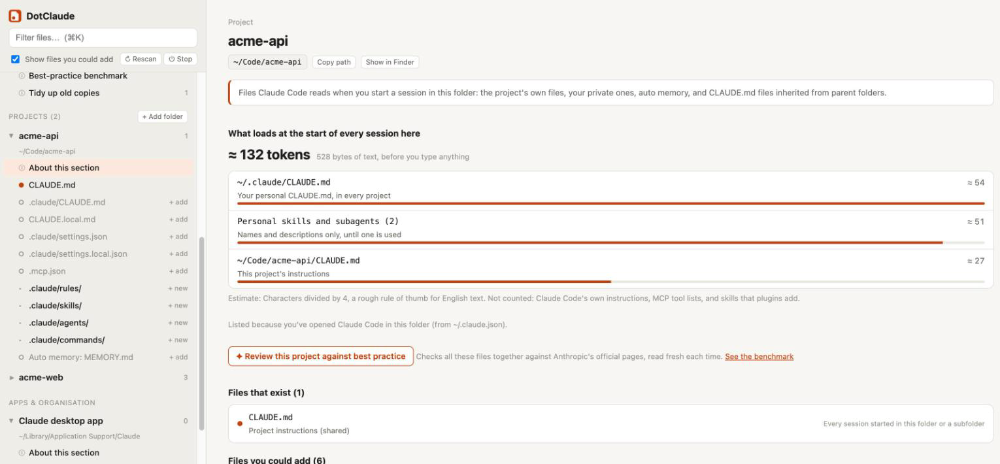

# DotClaude

**See, edit and improve every file Claude Code reads on your Mac, in one local web app.**

Claude Code's behaviour is shaped by a scatter of files: `CLAUDE.md` in several places, settings at three levels, rules, skills, subagents, hooks, MCP config, auto memory. DotClaude finds them all, explains what each one does and when it loads, shows how much context a session starts with, and reviews your files against Anthropic's official guidance.



- **One place for everything.** Your global `~/.claude/` files and every project you've opened Claude Code in, each file labelled with what it does, when it loads and whether it's shared or personal.
- **What loads at startup.** For each project, the files Claude Code reads before you type anything, with a size estimate.
- **Best-practice review.** One click checks a file, or a whole project, against Anthropic's docs and suggests rewrites you can apply.
- **Knows when the guidance changes.** Tracks the official pages it reviews against and tells you which of your files predate a change. Optional daily Mac notification.
- **Catches drift.** Flags files that should match but don't, such as `CLAUDE.md` and `AGENTS.md` side by side.
- **Safe to edit.** Every save backs up the old version first, with full history and one-click restore.

No install, no dependencies: a single Python file using only the standard library.

## Quick start

Requires macOS with Python 3.9 or newer (the Python that ships with macOS works). Tested on macOS 26 with Python 3.9 and 3.15. The core app has no macOS-only code, but other systems are untested; the Dock app and notifications are macOS only.

```bash
git clone https://github.com/ck-harrison/dotclaude.git
cd dotclaude
python3 dotclaude.py
```

It opens in your browser at `http://127.0.0.1:8765/` (or the next free port up to 8784).

**Dock app (optional):**

```bash
bash make-dock-app.sh --add-to-dock
```

This builds `~/Applications/DotClaude.app`. Clicking it starts DotClaude if it isn't running and opens it in your browser, reusing a running copy rather than starting a second one. Stop it with **Stop** in the sidebar. Launcher log: `~/Library/Logs/DotClaude/launcher.log`.

**Options:** `--port N` to pick a port, `--no-browser` to skip opening a tab, `--self-test` to run the built-in checks.

## What it shows

- **Global**: `~/.claude/` (CLAUDE.md, settings.json, settings.local.json, keybindings.json, rules, skills, agents, commands, output styles, workflows, themes, subagent memory, hook and status line scripts), the installed plugins list (read-only) and `~/.claude.json` (read-only)
- **Projects**: every folder you've opened Claude Code in (read from `~/.claude.json`), plus any folders you add. For each one: CLAUDE.md, .claude/CLAUDE.md, CLAUDE.local.md, AGENTS.md, settings files, .mcp.json, rules, skills, agents, commands, hook scripts, auto memory, CLAUDE.md files inherited from parent folders, and subfolder CLAUDE.md files
- **Claude desktop app**: `claude_desktop_config.json` (MCP servers for the chat app). claude.ai Projects are stored in your account, not on your Mac, so they don't appear
- **Organisation-managed**: `/Library/Application Support/ClaudeCode/` (read-only)

Hook and status line scripts are the files in `.claude/hooks/` plus any script a settings file runs as a hook or status line. Only scripts inside your home folder are listed.

## Features

### What loads at startup

Open a project (or **About this section** under Global) to see what Claude Code loads at the start of every session there, file by file. It follows the rules in Anthropic's [memory docs](https://code.claude.com/docs/en/memory.md): CLAUDE.md files in the folder and every folder above it, `@imports` up to 4 hops deep, AGENTS.md only when there's no CLAUDE.md in the folder or above, rules without `paths:`, the first 200 lines of auto memory, and only the descriptions of skills and subagents. It warns about imports that point to missing files.

The token count is an estimate (characters divided by 4). It leaves out Claude Code's own instructions, MCP tool lists and skills that plugins add.

### Best-practice review

Click **Review against best practice** on any file, or on a project's page to review all of its files together. DotClaude runs Claude Code on your Mac (`claude -p`) with only the WebFetch and WebSearch tools enabled, so it can read the web but can't touch your files. It reads the official pages that apply, then reports:

- findings sorted by severity, each linked to the official page that supports it
- suggested rewrites, shown as a diff. **Apply** saves the rewrite and backs up the current file first; **Open in editor** lets you adjust it before saving

Notes:

- It needs the `claude` command to work in Terminal. If you start the app some other way, set `DOTCLAUDE_CLAUDE_BIN=/path/to/claude`
- It uses your Claude plan's usage. A project review took about 45 seconds in testing
- Values in JSON files that look like keys or tokens (and everything under `env`) are replaced with `<redacted>` before anything is sent. Those files get findings but no rewrites
- If an official page couldn't be loaded, the results say so
- Reports are saved in `~/.dotclaude/reviews/`

### The benchmark, and knowing when it changes

**Best-practice benchmark** (sidebar, under Global) shows exactly what reviews judge your files against: nine official Anthropic pages (memory, best practices, skills, skill authoring, subagents, settings, permissions, hooks, MCP). A review reads the ones that apply to the files being reviewed, fresh each time, and every finding has to cite one of them.

DotClaude keeps a copy of each page in `~/.dotclaude/guidance/` and compares on every check, so it can tell you:

- when a page last changed, and **What changed** (a diff against the previous copy)
- which of your files were last edited before a page that applies to them changed. Those files also show a note when you open them

It checks when the app starts (if the last check is over 12 hours old) and when you click **Check for updates now**. It can only see changes from its first check onward.

**Notifications:** tick **Notify me when these pages change** to install a daily check at 09:00 (a macOS LaunchAgent, `~/Library/LaunchAgents/com.dotclaude.guidance-check.plist`). It runs even when DotClaude isn't open and shows a Mac notification only when a page changed. Untick it to remove the LaunchAgent. Log: `~/Library/Logs/DotClaude/guidance-check.log`. From Terminal:

```bash
python3 dotclaude.py --check-guidance          # check now, print what changed
python3 dotclaude.py --check-guidance --notify # same, plus a notification on changes
```

### Drift

The home page lists instruction files that look like one file kept under two names but no longer match: CLAUDE.md beside AGENTS.md, CLAUDE.md beside .claude/CLAUDE.md, or `~/.claude/CLAUDE.md` beside `~/AGENTS.md`. **Compare** shows the differences. Similar files in different folders (one template filled in per project) aren't flagged.

### Tidy up old copies

**Tidy up old copies** (sidebar, under Global) lists hand-made copies sitting next to a Claude file, such as `settings.json.bak-2026…` or `CLAUDE.md.v1-backup`. Ticked files move to `~/.dotclaude/archive/`, never deleted, and **Put back** returns any of them. A copy that one of your instruction files mentions by name starts unticked, because moving it would break that reference.

### Deleting a file

**Delete** (in each file's toolbar) moves the file to `~/.dotclaude/archive/`, so Claude Code stops reading it. Nothing is erased: the file shows up under **Tidy up old copies** marked *Deleted*, and **Put back** returns it. Read-only files have no Delete button.

### Backups and history

Every save, applied review suggestion and restore first copies the old version to `~/.dotclaude/backups/<timestamp>/`.

- **History** (in each file's toolbar): that file's earlier versions, newest first, each with the changes compared to the current file. **Restore this version** puts it back, and backs up the current version first, so a restore can be undone too.
- **Backups** (sidebar, under Global): every saved version of every file, grouped by file. This includes files DotClaude no longer manages, which you can view and copy but not restore.

## Safety and privacy

- Runs entirely on your machine. It only listens on 127.0.0.1, and every request needs a random token that changes each time you start it
- It can only read or write the Claude files it lists, never anything else
- JSON files aren't saved if they're invalid
- If Claude Code changed a file while you had it open, the app asks before overwriting it
- `~/.claude.json`, managed files and the desktop app's config are read-only
- Nothing leaves your Mac except the best-practice review (through your own `claude` command, with secrets redacted) and fetches of Anthropic's public docs pages

Folders you add are stored in `~/.dotclaude/config.json`.

`GET /health` is the only request that works without the token. It returns only the app name, version and URL, so a launcher or another local tool can tell whether DotClaude is running.

## Self-test

```bash
python3 dotclaude.py --self-test
```

This builds fake home folders in a temp directory and runs 162 checks (using a fake `claude` command for the review tests). They include cases that must fail: bad tokens, path traversal, invalid JSON, writes to read-only files, stale edits, a failing or missing `claude` command, rewrites aimed at files outside the review, a shutdown without the token, backup ids that try to escape the backups folder, restores onto read-only or unmanaged files, imports past 4 hops or inside code blocks, rules with `paths:`, drift between unrelated or identical files, scripts outside the home folder, saving the plugins list, archiving a live Claude file, deleting a read-only, unmanaged or changed-on-disk file, putting an archived file back over a newer one, a first guidance check reported as a change, being offline reported as a change, and macOS refusing the daily check. The last check confirms this README states the right number of checks.

## Repository layout

| Path | What it is |
|---|---|
| `dotclaude.py` | The whole app: server, page and self-test |
| `make-dock-app.sh` | Builds the optional macOS Dock app |
| `icon.svg`, `favicon.svg` | App and browser-tab icons |
| `docs/screenshot.png` | The screenshot above (taken with demo files) |
| `portfolio/` | Tile artwork for the project and the script that builds and checks it |

## Licence

MIT. See [LICENSE](LICENSE).

DotClaude is an independent project and isn't affiliated with or endorsed by Anthropic.
